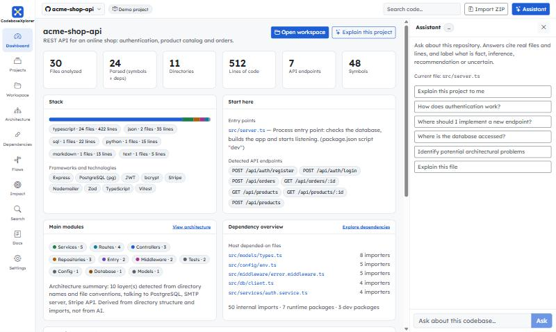
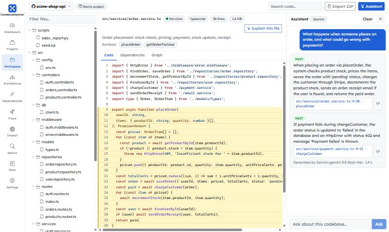
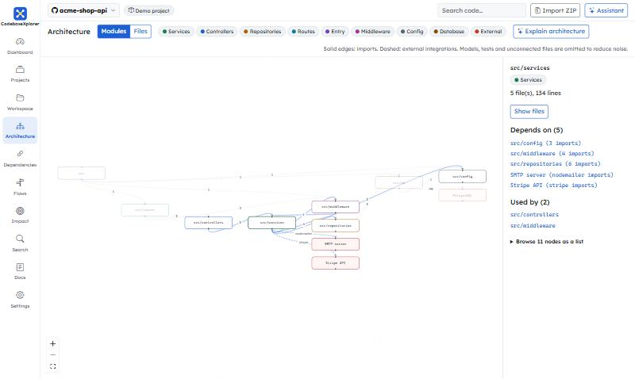
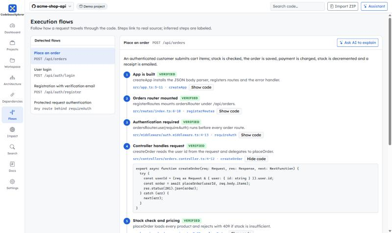
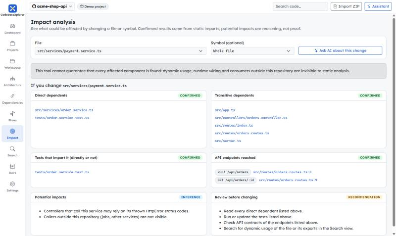
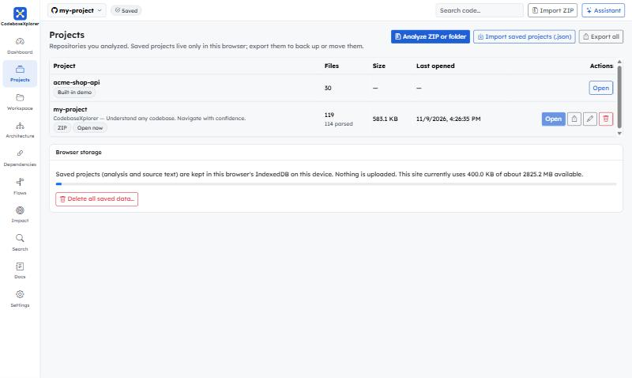
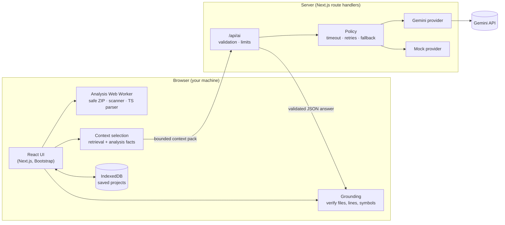
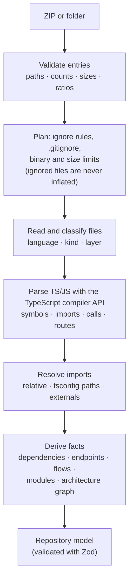

<p align="center">
  
</p>

<p align="center"><strong>Understand any codebase. Navigate with confidence.</strong></p>

<p align="center">
  <a href="https://github.com/laynierdev/codebasexplorer/actions/workflows/ci.yml"></a>
  
  
  
</p>

CodebaseXplorer is a developer tool that shortens the time it takes to understand an unfamiliar repository. Import a ZIP or a local folder and you get a navigable, **analysis-backed** view of the project: file tree, source viewer, architecture graph, dependency and impact analysis, execution flows, search, and an AI assistant whose answers cite real files and lines.

It is deliberately **not** "a chatbot with source files attached". Everything structural (symbols, imports, endpoints, layers, call chains, cycles) is extracted deterministically from the source. The AI explains and enriches those findings, and everything it claims is checked against the repository before you see it.

## Contents

- [Screenshots](#screenshots)
- [Features](#features)
- [How it works](#how-it-works)
- [Technology stack](#technology-stack)
- [Getting started](#getting-started)
- [Environment variables](#environment-variables)
- [Importing a repository](#importing-a-repository)
- [Supported languages](#supported-languages)
- [AI configuration](#ai-configuration)
- [Saved projects and export](#saved-projects-and-export)
- [Testing and quality](#testing-and-quality)
- [Project structure](#project-structure)
- [Security model](#security-model)
- [Accessibility](#accessibility)
- [Known limitations](#known-limitations)
- [Deployment](#deployment)
- [License](#license)

## Screenshots

| | |
|---|---|
| **Dashboard**: stack, entry points, endpoints, layers, concerns and an analysis summary that lists everything skipped.<br> | **Workspace**: file tree, highlighted source, and an AI answer whose citation opens the exact lines.<br> |
| **Architecture**: module-level graph derived from imports, with an inspector and drill-down to files.<br> | **Execution flows**: call chains traced across files, each step linked to source.<br> |
| **Impact analysis**: confirmed dependents, tests and endpoints, clearly separated from inferred risks.<br> | **Projects**: saved analyses live in your browser; export and import as JSON.<br> |

## Features

**Repository import and analysis**
- Import a **ZIP archive** or a **local folder**; analysis runs in a Web Worker in your browser.
- Ignores `node_modules`, `.git`, build output, caches, lock files and binaries, and respects `.gitignore` (root and nested). Configurable file, archive and count limits.
- Nothing is silently dropped: the dashboard lists every skipped item with its reason.
- Detects languages, frameworks, entry points (from `package.json` and framework conventions), API endpoints (Express-style routers and Next.js route files), layers and modules.

**Exploration**
- Expandable, keyboard-navigable file tree, syntax-highlighted viewer with line numbers, symbol outline, per-file dependencies and a local graph.
- **Architecture**: module (directory) graph and file graph with filtering by layer, zoom/pan, node inspector and a keyboard-friendly node list. Large repositories are capped and grouped instead of rendered as one giant graph.
- **Dependencies**: file-to-file, module-to-module matrix, external packages and **circular dependencies** (Tarjan SCC).
- **Execution flows**: call chains from each endpoint's handler through project functions, resolved via imports; every step links to source and is labelled *verified* (static evidence) or *inference*.
- **Impact analysis**: direct and transitive dependents, affected tests and endpoints (confirmed through imports) plus reasoning about potential impact, never claiming completeness.
- **Search**: file names, text, symbols, and semantic search that can be re-ranked by the AI.
- **Documentation**: seven generated sections (overview, architecture, modules, API, flows, dependencies, onboarding) grounded in analysis facts, optionally written by the AI, exportable as Markdown.

**AI assistant** (Gemini, with a credential-free mock mode)
- Overview, file/module/architecture/flow explanations, impact reasoning, free-form Q&A, documentation writing and semantic ranking.
- Answers are split into **fact / inference / recommendation / uncertain** blocks. Facts must carry references.
- Every file path, line range and symbol the model cites is **validated against the repository**; wrong citations are corrected or dropped and unverifiable facts are downgraded. Mentions of files that do not exist are flagged.
- Only a small, relevant **context pack** is sent to the model, never the whole repository.

**Projects**
- Save multiple projects in the browser (IndexedDB), reopen, rename, delete.
- **Export / import JSON** with schema versioning, validation, integrity checks and per-project conflict resolution (keep, replace, or import as a copy).

## How it works



**Analysis pipeline** (deterministic, no AI, no code execution):



**An AI request**, step by step:

1. The browser builds a **context pack** for the task: ranked files, symbol tables, import relations, line-numbered excerpts and deterministic analysis facts, within a size budget.
2. `/api/ai` validates it, then calls Gemini with a fixed system instruction and the pack inside a delimited, sanitized `<repository_data>` block. The answer must match a JSON schema. Timeouts and retries are bounded; on failure it falls back to the mock provider (flagged in the UI) or returns an error, depending on configuration.
3. The browser **grounds** the answer: citations are checked and corrected against the real files; excerpts shown in the UI are read from the repository, never from the model.

## Technology stack

| Area | Choice |
|---|---|
| Framework | Next.js 16 (App Router), React 19, TypeScript (strict) |
| UI | Bootstrap 5 + custom CSS, Bootstrap Icons, Lexend font. No Tailwind, no shadcn/ui |
| Graphs | React Flow (`@xyflow/react`) with dagre layout |
| Syntax highlighting | Shiki (JavaScript regex engine, grammars loaded on demand, high-contrast theme) |
| Parsing | TypeScript compiler API (`typescript` pinned to 6.0.3; 7.x has no JS API) |
| Validation | Zod 4: domain models, API payloads, AI output, stored data, export files |
| ZIP | `fflate`; ignore rules with `ignore` |
| AI | Google Gemini via `@google/genai`, behind a provider abstraction |
| Persistence | IndexedDB behind a `ProjectStore` abstraction (in-memory fallback) |
| Tests | Vitest, `fake-indexeddb` |
| Quality | ESLint (Next + jsx-a11y rules), `tsc --noEmit`, GitHub Actions |

## Getting started

**Requirements:** Node.js 20.9 or newer (22 or 24 recommended) and npm.

```bash
git clone https://github.com/laynierdev/codebasexplorer.git
cd codebasexplorer
npm install
cp .env.example .env.local   # optional: add a Gemini API key, see below
npm run dev
```

Open <http://localhost:3000>. A bundled demo project (a small Express API) is loaded so you can explore immediately. No credentials are needed: without a Gemini key the app runs in **mock mode**.

### Scripts

| Script | What it does |
|---|---|
| `npm run dev` | Development server with hot reload |
| `npm run build` / `npm start` | Production build and server |
| `npm run lint` | ESLint |
| `npm run typecheck` | TypeScript strict check |
| `npm test` | Unit and integration tests |
| `npm run test:live` | Optional tests against the real Gemini API (needs a key; uses quota) |
| `npm run check` | Lint, types, tests and build in one go |
| `npm run icons` | Regenerates favicon and PNG icons from `public/brand/*.svg` |

## Environment variables

Read on the **server only**; they are never sent to the browser. Copy `.env.example` to `.env.local`.

| Variable | Default | Description |
|---|---|---|
| `AI_PROVIDER` | `auto` | `auto`: Gemini when `GEMINI_API_KEY` is set, otherwise mock. `gemini`: always try Gemini. `mock`: never call an external API |
| `GEMINI_API_KEY` | none | Key from <https://aistudio.google.com/apikey> |
| `GEMINI_MODEL` | `gemini-3.5-flash` | Model name (names change over time; check the Gemini docs) |
| `AI_TIMEOUT_MS` | `45000` | Timeout of one model call (1000-55000) |
| `AI_MAX_ATTEMPTS` | `3` | Attempts for temporary failures such as 503 or malformed output (1-4) |
| `AI_FALLBACK_TO_MOCK` | `true` | If Gemini fails, answer with the mock and flag it in the UI; `false` shows an error instead |

Invalid values never crash the app: it reports the problem in **Settings** and runs in mock mode.

## Importing a repository

Use **Import ZIP** in the header, or **Projects → Analyze ZIP or folder**.

- **ZIP**: a single top-level folder (as in GitHub downloads) is stripped automatically.
- **Local folder**: your browser asks permission to read it; files stay on your machine.
- The default limits (editable in **Settings**, saved in your browser): archive 50 MB, 250 MB expanded, 1 MB per file, 10,000 files analyzed, 50,000 entries.
- Always skipped: `node_modules`, `.git`, `dist`, `build`, `out`, `.next`, `coverage`, caches, lock files, minified files, source maps and binary files. Add your own patterns in `.gitignore` syntax.
- Invalid archives (path traversal, absolute paths, duplicates, bombs) are rejected with a specific message.

## Supported languages

| Level | Languages |
|---|---|
| **Full analysis** (symbols, imports, calls, routes, flows) | TypeScript, JavaScript: `.ts` `.tsx` `.js` `.jsx` `.mjs` `.cjs` `.mts` `.cts` |
| **Indexed as text** (searchable, listed, highlighted, used for context) | JSON, Markdown, SQL, Python, CSS/SCSS, HTML, YAML, shell, Go, Java/Kotlin, Rust, Ruby, PHP, C#, C/C++ |

Parsers are pluggable (`src/analysis/parsers`): implement `LanguageParser` and register it to add a language.

## AI configuration

- **Mock mode** (no key): answers are assembled from the deterministic analysis facts and name/symbol matching. It is useful for navigation but does not read or reason about code, and says so.
- **Gemini mode**: structured JSON output validated with Zod, low thinking level for latency, bounded retries with backoff, a total time budget below typical serverless limits, and fallback to the mock when allowed.
- **Quotas**: free-tier keys have small per-model daily limits. A daily-quota error is detected, not retried, and reported clearly ("quota exhausted, resets in about N h"), after which the mock answers (or an error is shown, depending on `AI_FALLBACK_TO_MOCK`).
- **Live tests**: `npm run test:live` exercises the real API (structured output, grounding quality, prompt-injection resistance). It consumes quota, so use it sparingly.

## Saved projects and export

Analysis results, including the **full text of the source files**, can be saved in your browser's IndexedDB so you can reopen a project without importing it again.

- Saving is **explicit**: a dialog states what is stored and where before anything is written. Nothing is uploaded. You can enable automatic saving afterwards.
- Delete one project or everything from **Projects**. Export a project (or all of them) as a versioned JSON file and import it elsewhere. Imports are validated against the schema and for consistency, report unknown fields instead of dropping them silently, and let you choose per conflict: keep the existing project, replace it, or import a copy.
- AI-written documentation is saved with its project. Chat history is not persisted.
- If the browser blocks storage (e.g. some private modes), the app keeps working in memory and tells you that nothing will survive a reload.

## Testing and quality

```bash
npm run check
```

- **Unit and integration tests** (Vitest): ZIP safety (traversal, bombs, tampered sizes), ignore rules, the TypeScript parser, import resolution, analysis of the demo and of this repository itself, graphs and impact, search, AI configuration/retry/providers/HTTP handlers (with fake clients), context selection, prompt-injection defenses, grounding, persistence (contract tests run against the IndexedDB and in-memory stores, including corruption and quota errors), export/import validation and migrations, a complete ZIP → analysis → AI → save → export → restore workflow, and a 3,000-file repository.
- **Static checks**: ESLint (including `jsx-a11y`) and strict TypeScript.
- **Manual and automated browser checks** performed during development: axe-core audits of every page and dialog (WCAG 2.2 AA, zero violations at the time of release), keyboard navigation, mobile/tablet layouts, production-mode CSP verification and the end-to-end flow with a real Gemini key.

## Project structure

```
src/
  app/            Next.js routes: pages (dashboard, workspace, architecture, dependencies,
                  flows, impact, search, docs, projects, settings) and /api/ai route handlers
  components/     UI components (no business logic)
  context/        React state: explorer (repository, AI) and projects (persistence)
  domain/         Zod schemas (source of truth) and inferred types
  analysis/       Safe ZIP extraction, scanner, parsers, resolver, endpoints, flows, graphs, worker
  ai/             Provider abstraction, Gemini and mock providers, prompts, context selection,
                  grounding, retry policy, configuration, HTTP handlers
  persistence/    ProjectStore (IndexedDB / memory), export/import, migrations, integrity checks
  lib/            Pure helpers (graph analysis, search, docs generation, highlighting)
  mock/           The bundled demo repository
tests/            Vitest suites (mirrors src/)
docs/             Product specification (guide.md) and screenshots
public/brand/     Logo and social image;   public/icons/  PNG icon set
```

## Security model

Repository content is untrusted. It is never executed, scripts are never run, dependencies are never installed, archives are validated before extraction, API keys stay on the server, prompts treat repository text as data, and every AI citation is verified. See [SECURITY.md](SECURITY.md) for the full list, the deployment caveat and how to report a vulnerability.

## Accessibility

Semantic landmarks, a skip-to-content link, labelled controls, accessible dialogs (focus trap, Escape, focus restore), a file tree that follows the WAI-ARIA tree pattern (single tab stop, arrow keys), a list alternative to the graph, per-page titles with focus moved to the content after navigation, alert/status regions for errors and progress, high-contrast code theme, 24 px minimum targets, and `prefers-reduced-motion` support.

## Known limitations

- **Static analysis only.** Dynamic imports with computed paths, dependency injection, runtime wiring, and consumers outside the repository are invisible. Impact results and flows say so and never claim completeness.
- **Flows follow named imports.** Method calls on instances, callbacks and framework magic are not traced. Endpoint detection covers Express-style routers and Next.js route files.
- **Monorepo packages** (workspace-to-workspace imports) are not resolved; `tsconfig` `paths`/`baseUrl` are.
- **Only TypeScript/JavaScript** have deep analysis; other languages are text-only.
- **Large repositories** are bounded by browser memory and the configurable limits; the file graph shows at most 250 nodes (use the module view or filters). A 3,000-file repository is covered by tests; much larger ones are untested.
- **Symlinks** inside ZIPs are not detected (nothing is ever written to disk, so they cannot escape).
- **Mock mode** is deliberately simple. Gemini free-tier quotas are small.
- **Storage is per browser.** Clearing site data deletes saved projects; export a backup first.
- **No authentication.** A public deployment exposes `/api/ai` (see below).

## Deployment

The app is a standard Next.js project and deploys to [Vercel](https://vercel.com) without extra configuration (`vercel.json` pins the framework and commands).

1. Push the repository to GitHub (the CI workflow in `.github/workflows/ci.yml` runs lint, type checking, tests and the production build on Node 22 and 24, using the mock provider so no secrets are needed).
2. Import the repository in Vercel.
3. Add the environment variables from the table above under **Project Settings → Environment Variables**. Mark `GEMINI_API_KEY` as sensitive. For a **public demo, set `AI_PROVIDER=mock`** or enable Deployment Protection: anyone who can open a public deployment can spend your Gemini quota.
4. Deploy. The AI route declares a 60 s maximum duration; if your plan allows less, lower `AI_TIMEOUT_MS` and `AI_MAX_ATTEMPTS` accordingly.

Never commit `.env.local` or any API key. Production responses include a Content Security Policy and other security headers (see `next.config.ts`).

## License

[MIT](LICENSE). The product specification that guided development is kept in [docs/guide.md](docs/guide.md).
